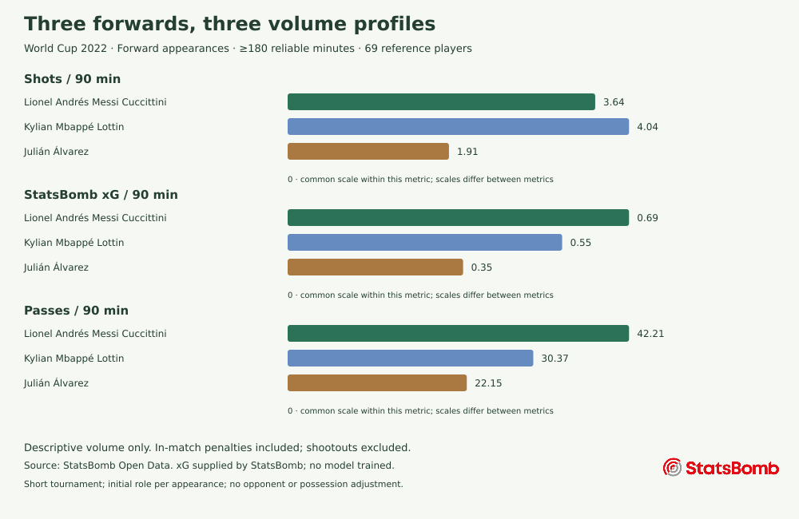

# Three forwards, three volume profiles

How did Messi, Mbappé and Álvarez differ in shot volume, provider xG and passing
involvement during the 2022 World Cup? This is a descriptive starting point for
choosing match footage to review, rather than a recommendation to recruit anyone.

## Selection and reference group

The subjects are three recognisable finalists with at least 450 reliable minutes
in Forward appearances: Messi and Álvarez from Argentina, Mbappé from France.
This is a purposive example, not a search for the tournament's best players.
The reference group is all 69 players with at least 180 reliable minutes in
Forward appearances across the complete 64-match tournament. No team filter.
The subject inclusion rule (450 minutes) and reference threshold (180) differ
intentionally; neither removes short-tournament uncertainty. Only appearances
whose initial provider lineup position maps to Forward contribute here.



Scales start at zero and are shared within each metric; they differ between metrics.

| Player | Role appearances | Reliable min | Shots | Goals | StatsBomb xG | Penalty shots | Shots/90 | xG/90 | Passes/90 |
| --- | ---: | ---: | ---: | ---: | ---: | ---: | ---: | ---: | ---: |
| Lionel Andrés Messi Cuccittini | 7 | 791.09 | 32 | 7 | 6.03 | 5 | 3.64 | 0.69 | 42.21 |
| Kylian Mbappé Lottin | 7 | 690.47 | 31 | 8 | 4.23 | 2 | 4.04 | 0.55 | 30.37 |
| Julián Álvarez | 6 | 471.31 | 10 | 4 | 1.85 | 0 | 1.91 | 0.35 | 22.15 |

## Observations and practical interpretation

Mbappé recorded 4.04 shots per 90 reliable minutes, Messi 3.64 and Álvarez 1.91.
Messi's provider xG per 90 was 0.69, ahead of Mbappé's 0.55 and Álvarez's 0.35
in this sample. These orderings differ: more shots alone do not establish better
chances or a better player. In-match penalty shots (5, 2 and 0 respectively) are
included, so the xG comparison must not be presented as an open-play comparison.

Messi attempted 42.21 passes per 90, Mbappé 30.37 and Álvarez 22.15. This describes
recorded passing involvement in these role appearances; it does not measure
creativity, progressive passing or pass difficulty. Those metrics are not available.
Álvarez has six Forward appearances here, rather than seven assumed full matches.
Minutes are elapsed playing time, not nominal match durations.

Against the reference population, Messi's displayed volume percentiles are P89
for shots/90, P98 for xG/90 and P91 for passes/90; Mbappé's are P96, P91 and P63;
Álvarez's are P47, P73 and P41. These are rounded empirical midranks with ties,
not quality ratings or probabilities. Aggregates and percentiles exported to nine decimal places
are in [the reproducible export](case-study.json).

The useful next step is to review how those actions arose: for example, inspect
the final in Match centre, distinguish an in-match penalty from a shootout,
and select a shot to see its source ID and provider xG. The figures can guide
questions for video review; they cannot answer tactical or recruitment questions
on their own. Goals (7, 8 and 4) remain descriptive outcomes, not evidence of a
stable finishing ability or future performance.

## Limits and uncertainty

A short tournament has few matches and an uneven distribution of minutes.
Teammates, opponents, score state, set pieces, penalties, substitution patterns
and team possession affect opportunities. Role groups are coarse and fixed by
the initial lineup position for each appearance; they do not capture tactical
changes. Argentina and France do not have identical schedules or contexts.
Per-90 scaling does not remove these differences. Small samples can change the
ordering sharply; no confidence interval, causal effect or career prediction is
claimed. xG is supplied by StatsBomb; PitchScope did not train the provider model.

## Reproduce and compare with the application

Use the existing migrated, fully imported database. This command reads only;
never point test schema recreation at the demonstration database. With PGlite,
stop the API while leaving the database running because only one connection is
supported in this setup. Export DATABASE_URL for the chosen database/port first.

```bash
PYTHONPATH=backend uv run python scripts/case-study.py --output work/case-study --check docs/case-study.json
```

This calls `services.comparison` and `services.coverage`, the same SQL-backed
services as the API and PDF. It refuses incomplete or synthetic tournaments,
asserts the subject minutes, and checks stored JSON equality after rounding
exports to nine decimal places. This avoids insignificant differences from SQL
floating-point SUM order across PostgreSQL builds; application rates are unchanged. It exports
this article, a vector chart and a small aggregate JSON analysis. No provider
event payloads or raw files are exported. CI repeats the command on native
PostgreSQL after the pinned import and compares screen values with this JSON.
The screenshot and PDF checks compare all shared metric values with the API.

Open locally:
- Messi/Mbappé: `/?view=compare&left=5503&right=3009&role=Forward&min=180`
- Messi/Álvarez: `/?view=compare&left=5503&right=29560&role=Forward&min=180`
- Final: `/?view=matches&match=3869685`

Conventions for minutes, temporary absences, red cards, missing values, weighted
ratios and shootout exclusion are unchanged: [methodology](methodology.md).
Source: StatsBomb Open Data / hudl/open-data, pinned commit
`4b73468fc5b0f1950f9f66fada70ad3a4f9327cb`, transformations `1.2.0`.
This attributed non-commercial research example shares analysis, not a dataset;
[provider rights](data-rights.md) still apply. No raw-event public API is deployed.


